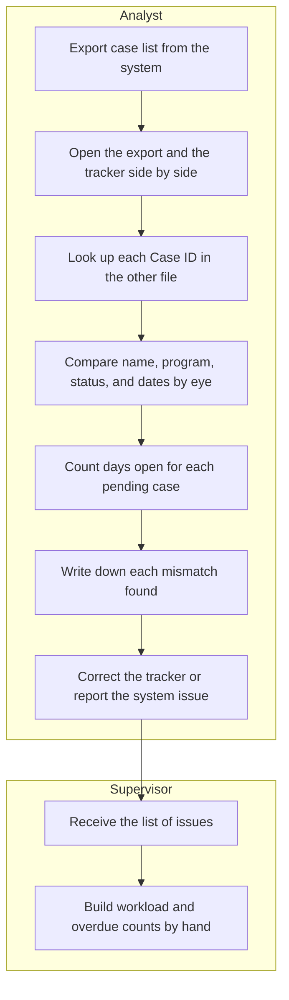
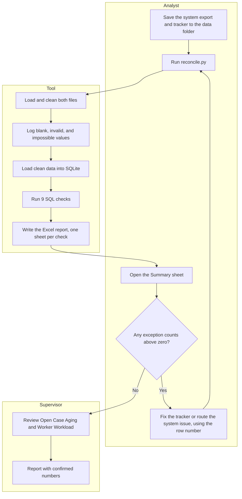

# 🧭 Process Map: Current State and Future State

How tracker reconciliation runs as a manual process, and how the process runs with this tool. The current state describes the manual comparison this tool replaces. The future state follows the steps in `reconcile.py`.

## 📍 Current State (Manual)

### Pain Points

| ID | Pain Point | Effect |
|---|---|---|
| PP-01 | Every Case ID gets looked up one at a time | Review time grows with every case added |
| PP-02 | Fields get compared by eye | Near matches such as `1O24` and `1024` or `Akina` and `Akana` slip through |
| PP-03 | No row numbers on findings | Each correction starts with another search through the file |
| PP-04 | Days open counted by hand | Aging and overdue status depend on who does the math and when |
| PP-05 | No record of what got checked | No proof the review happened, and no way to repeat the same review |

## 🎯 Future State (With This Tool)

## 🔄 Current vs. Future State

| Step | Current State | Future State |
|---|---|---|
| Matching records | Each Case ID looked up by hand | Every record matched at once on a cleaned Case ID |
| Comparing fields | By eye, case by case | Name, program, status, and decision date compared on every matched case |
| Bad values | Found only if someone notices | Blank, invalid, and impossible values logged on load with source and row number |
| Duplicates | Found only if someone notices | Duplicate Case IDs listed for each source |
| Aging | Days counted by hand | Days open, aging bucket, and Overdue, Due Soon, or On Track set for every pending case |
| Late decisions | Not tracked | Decided cases past target listed with days over |
| Workload | Built by hand | Open, overdue, and late cases summarized by worker |
| Fixing issues | Search the file again for each finding | Row number on every finding |
| Proof of review | None | Saved Excel report with a Summary sheet |
| Repeat review | Start over | Run the script again |

## 📝 Notes

- The analyst still decides every correction. The tool finds and lists issues, and a person fixes them in the tracker or routes them to the system owner.
- The loop between the analyst and the tool repeats until every exception count on the Summary sheet reads zero, or the remaining issues get routed to someone else.
- Two fields stay outside the future state comparison: received date and worker. See GAP-01 and GAP-02 in [`DATA_MAPPING.md`](DATA_MAPPING.md).
