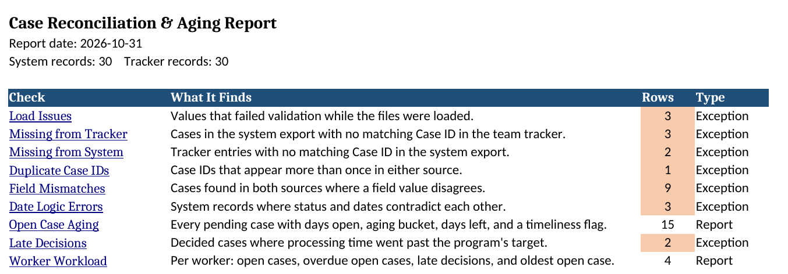
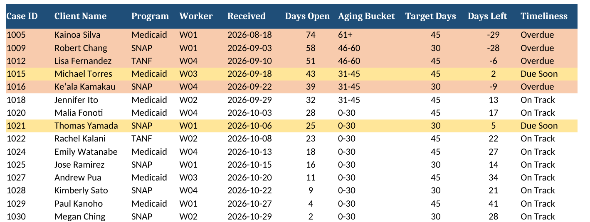

# ⏳ Case Reconciliation & Aging Report

Excel, SQL, and Python tool for reconciling a system export against a team's manual case tracker, then flagging overdue and late cases. Designed for operations and QA teams that keep a side tracker in Excel and need to confirm both sources agree before reporting.

Python loads and cleans both files, SQL runs the reconciliation and timeliness checks, and the results come back as a formatted Excel workbook with one sheet per check.

## 🔍 What It Does

**Reconciliation**
- Flags cases in the system export with no match in the tracker
- Flags tracker entries with no match in the system (often a keying error in the Case ID)
- Flags duplicate Case IDs in either source
- Compares client name, program, status, and decision date for every matched case and lists each disagreement
- Ignores differences in capitalization and extra spaces, so `"  ana  LOPEZ "` matches `Ana Lopez`

**Data quality on load**
- Flags impossible or badly formatted dates (such as `2026-02-30`)
- Flags blank required fields and status or program values outside the allowed list
- Records the source file and row number for every issue so it can be found and corrected

**Timeliness**
- Flags system records where status and dates contradict each other (approved with no decision date, pending with a decision date, decided before received)
- Ages every pending case into 0-30, 31-45, 46-60, and 61+ day buckets as of the report date
- Marks each open case Overdue, Due Soon (7 days or less left), or On Track against its program's processing target
- Lists decided cases that went past their processing target, with days over
- Summarizes open, overdue, and late cases by worker

## 📊 Sample Output

The Summary sheet links to each check. Exception counts turn red when issues are found and green when a check comes back clean. Counts are Excel formulas, so they update if a reviewer edits or clears rows.

The Open Case Aging sheet highlights overdue cases in red and cases due within 7 days in yellow.

## 🧪 Sample Data

`system_export.csv` holds 30 case records. `team_tracker.xlsx` holds 30 tracker rows with intentional discrepancies:

| Planted issue | Example | Caught by |
|---|---|---|
| Recent cases not logged in tracker | 1024, 1027, 1030 | Missing from Tracker |
| Case ID keyed with a letter O | `1O24` | Missing from System |
| Case in tracker, never entered in system | 1031 | Missing from System |
| Same case listed twice | 1006 | Duplicate Case IDs |
| Status, program, name, and date conflicts | 1009, 1011, 1008, 1002 | Field Mismatches |
| Impossible date, blank status, misspelled status | 1019, 1025, 1028 | Load Issues |
| Approved with no decision date, decided before received | 1013, 1014 | Date Logic Errors |
| Pending cases past target | 1005, 1009, 1012, 1016 | Open Case Aging |
| Decisions made after target | 1004, 1007 | Late Decisions |

Two records test that clean data passes. Case 1003 has `denied` in lowercase and case 1010 has extra spaces in the name. Neither is flagged.

Processing targets in the sample (SNAP 30 days, TANF and Medicaid 45 days) are set in `SLA_TARGETS` at the top of `reconcile.py`. Edit them to match the rules for your program.

## 🧰 Tools Used

- Python 3 (pandas, openpyxl, sqlite3), AI-assisted development
- SQL (SQLite): joins, `UNION ALL`, CTEs, `CASE` logic, date math, grouped summaries
- Microsoft Excel: tracker input, formatted report output, formulas, conditional formatting

SQLite runs inside Python with no database server to install. The queries use standard SQL plus SQLite's `julianday()` for date differences.

## 📁 File Overview

- `reconcile.py` - Loads and cleans both files, builds the database, runs the checks, writes the report
- `sql/schema.sql` - Creates the tables for system cases, tracker cases, processing targets, and load issues
- `sql/checks/` - One `.sql` file per check. Line 1 is the sheet name, line 2 is the Summary description
- `data/system_export.csv` - Sample system of record export
- `data/team_tracker.xlsx` - Sample team tracker with intentional discrepancies
- `output/reconciliation_report.xlsx` - Report generated from the sample data

## ▶ How to Use It

1. Install dependencies: `pip install -r requirements.txt`
2. Run `python reconcile.py`
3. Open `output/reconciliation_report.xlsx` and start on the Summary sheet

To use your own files, replace the two files in `data/` or change `SYSTEM_FILE` and `TRACKER_FILE` in the script. If your tracker uses different column headers, update `TRACKER_COLUMNS`. Set `REPORT_DATE = date.today()` for live aging.

To add a check, drop a new numbered `.sql` file in `sql/checks/`. It shows up as a new sheet and a new Summary row on the next run.

## 📌 Purpose

Built to reflect a common operations problem: the system of record and the team's working tracker drift apart, and nobody finds out until a report or audit is wrong. Running this before reporting surfaces every gap with a row number attached, so corrections take minutes instead of a manual line-by-line comparison.
